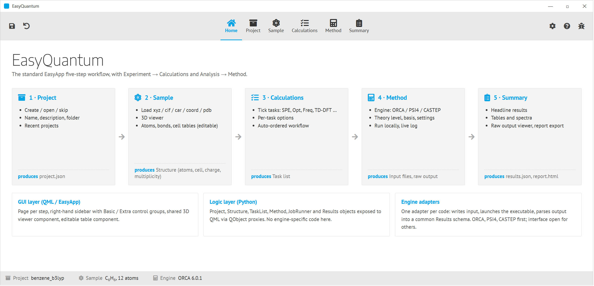
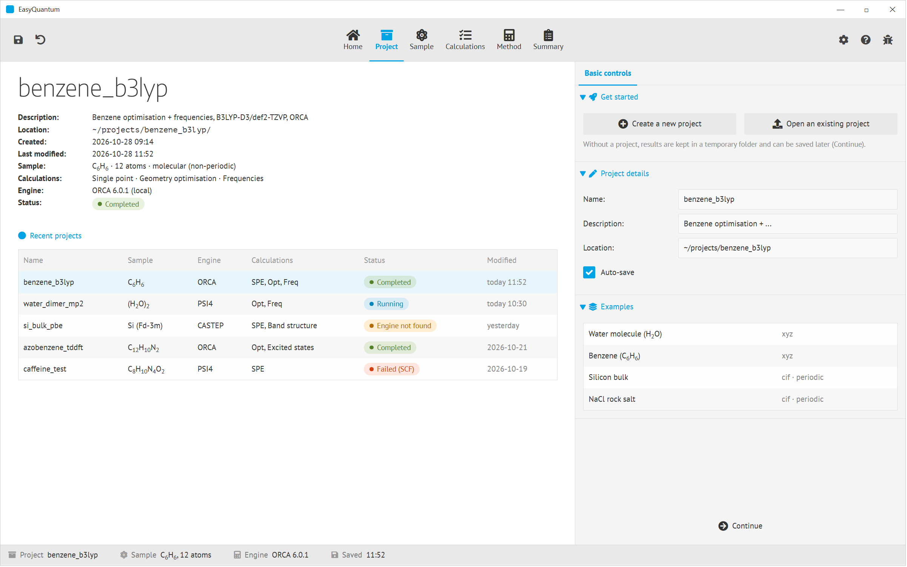
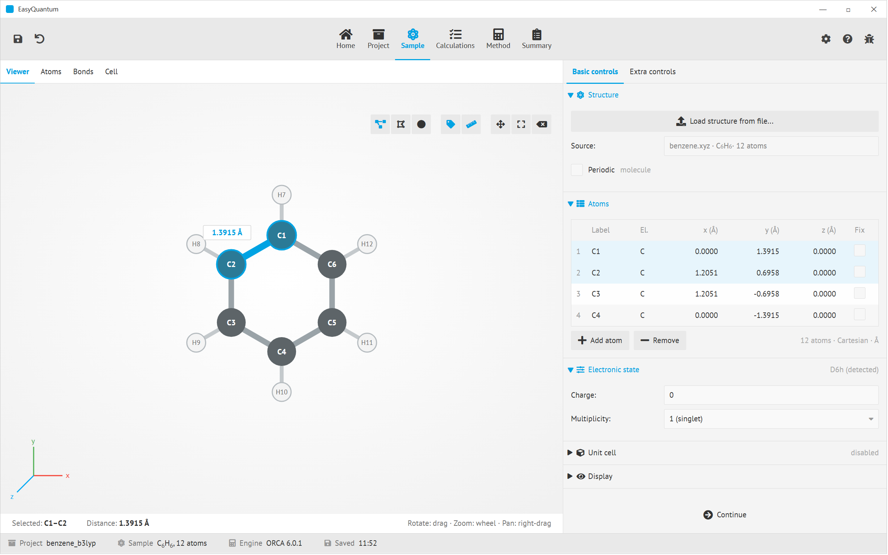
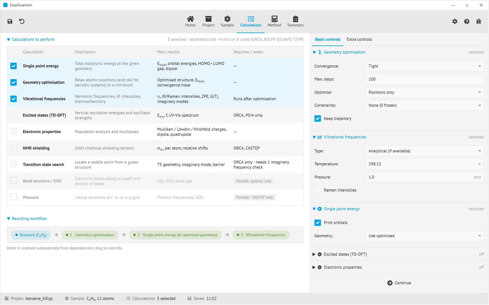
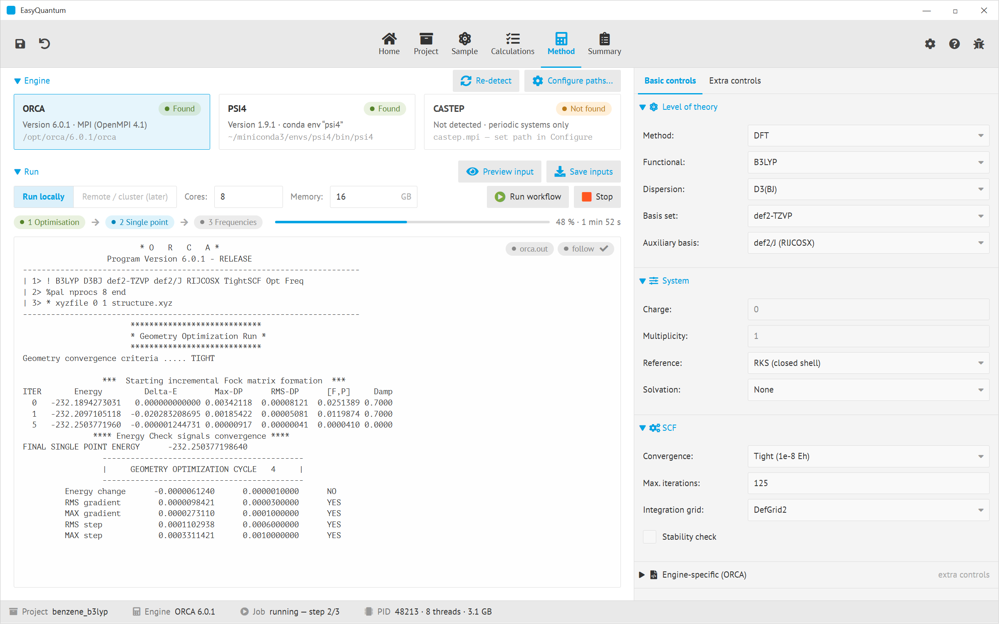
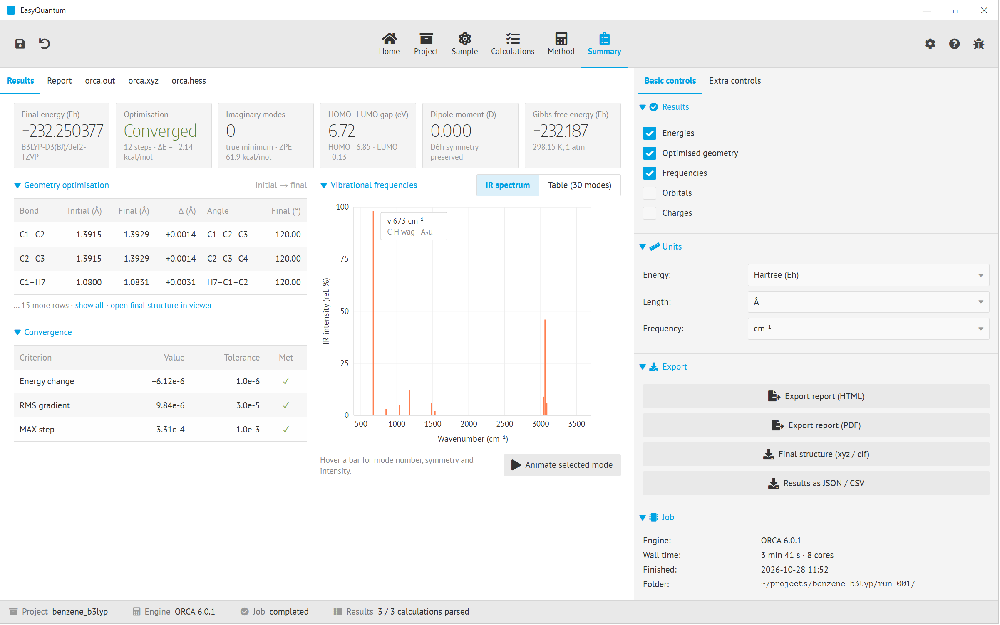

# EasyQuantum — general design

*A GUI for running quantum-chemistry codes, built on the EasyScience / EasyApp framework.*

---

## 1. Purpose and scope

EasyQuantum lets a user load a molecule or crystal, pick what to compute, choose a code and
a level of theory, run the calculation on the local machine and read the results — without
hand-writing input files or parsing output. The first release targets three engines:

| Engine | Systems | Typical use |
|---|---|---|
| ORCA | molecules | DFT / wave-function methods, TD-DFT, NMR |
| PSI4 | molecules | DFT, MP2, CC; Python-native |
| CASTEP | periodic (crystals, surfaces) | plane-wave DFT, bands, phonons |

Everything engine-specific is confined to an *adapter*. The GUI, the data model and the
workflow are engine-agnostic, so adding a fourth code (Gaussian, VASP, Quantum ESPRESSO,
xTB) is a new adapter, not a new application.

The name is a placeholder. Alternatives: EasyQChem, EasyMolecule.

## 2. Workflow

EasyQuantum keeps the standard five-step EasyApp workflow and the standard EasyApp chrome.
Two steps are renamed because the diffraction vocabulary does not fit:

| EasyApp step | EasyQuantum step | Content |
|---|---|---|
| 1 Project | Project | create / open / skip project, recent projects |
| 2 Sample | Sample | load structure, 3D view, atoms / bonds / cell tables |
| 3 Experiment | **Calculations** | table of calculation types to perform, with per-type options |
| 4 Analysis | **Method** | engine selection, level of theory, run control, live log |
| 5 Summary | Summary | headline results, tables, spectra, raw output viewer, export |

Steps unlock in order: Sample needs a project decision, Calculations needs a structure,
Method needs at least one calculation ticked, Summary needs a finished (or running) job.
Going back is always allowed; editing an upstream step marks downstream results as stale.



### Common chrome (all tabs)

* **Top bar**: application logo, the five numbered step tabs (done = teal dot, active =
  filled, locked = greyed), theme / settings / help icons.
* **Main area** (left, ~70 %): one or two cards with the page's primary content — viewer,
  tables, log, charts.
* **Sidebar** (right, 400 px): the EasyApp "Basic controls / Advanced controls" switch and
  collapsible groups. Basic shows what 90 % of users touch; Advanced exposes everything else.
* **Status bar**: project name, sample formula, engine, job state. Always visible so the user
  never loses track of what is loaded and what is running.

## 3. The tabs

### 3.1 Project



Main area: a *Current project* card (name, description, folder, dates, and a one-line
summary of sample / calculations / engine / status / files) and a *Recent projects* table.
The recent-projects table doubles as a job overview: a row's status pill shows
Completed / Running / Failed / Engine not found, so a user returning to the app sees at a
glance what is still going.

Sidebar: *Get started* (Create new, Open existing, Continue without a project),
*Project details* (editable name / description / location, auto-save), *Examples*
(bundled structures: water, benzene, Si bulk, NaCl).

Project on disk is a folder:

```
benzene_b3lyp/
  project.json        # everything the GUI needs to restore its state
  structure.xyz       # the sample as loaded (original file kept verbatim)
  run_001/            # one folder per run: inputs, raw outputs, parsed results.json
  report.html         # last exported report
```

### 3.2 Sample



Main area, left card: **structure viewer** (ball-and-stick / wireframe / spacefill, labels,
measure tool, axes gizmo). Clicking two atoms shows the distance, three atoms an angle, four
a dihedral. The selection is shared with the tables: selecting a row highlights the atom
and vice versa. Technically this is the same Qt3D / QtQuick3D viewer component as in
EasyDiffraction, reused.

Main area, right card: three tables behind a segmented control.

* **Atoms** — label, element, x/y/z (Cartesian, fractional or Z-matrix), "fix" flag used
  as a constraint by the optimiser. Editable; edits are reflected in the viewer and the
  bond table immediately. Add / remove rows.
* **Bonds** — pair, length, auto-detected from covalent radii with an adjustable scale
  factor; the user can add or delete bonds (affects display and internal coordinates only,
  not the physics).
* **Cell** — a, b, c, α, β, γ, lattice vectors, space group. Greyed out unless *Periodic*
  is on.

Sidebar: *Structure* (Load from file: xyz, cif, car/mdf, coord, pdb, mol2, POSCAR, CASTEP
.cell — read through ASE so new formats are free; source file, formula, atom / bond count,
periodic toggle), *Electronic state* (charge, multiplicity, detected point group),
*Unit cell* (disabled for molecules), *Display*. Advanced controls add k-point grid and
symmetry tolerance for periodic systems, and supercell building.

Turning *Periodic* on or off switches the whole application between "molecule" and
"crystal" mode: it enables the Cell table, changes which calculations and engines are
offered, and switches coordinate defaults to fractional.

### 3.3 Calculations (replaces Experiment)



Main area: a **check-list table** of calculation types. Each row has a checkbox, a name,
a one-line description, the main results it produces and a notes column that states
restrictions (engine, periodic-only). Rows that the current system or engine cannot do are
shown but disabled, with the reason, rather than hidden — this is how the user discovers
that CASTEP is needed for phonons.

Initial set:

| Calculation | Molecules | Periodic | Engines |
|---|---|---|---|
| Single point energy | ✓ | ✓ | all |
| Geometry optimisation (positions, optionally cell) | ✓ | ✓ | all |
| Vibrational frequencies / thermochemistry | ✓ | Γ-point | all |
| Excited states (TD-DFT) | ✓ | – | ORCA, PSI4 |
| Electronic properties (charges, multipoles) | ✓ | ✓ | all |
| NMR shielding | ✓ | ✓ | ORCA, CASTEP |
| Transition-state search | ✓ | – | ORCA |
| Band structure / DOS | – | ✓ | CASTEP |
| Phonons | – | ✓ | CASTEP |

Below the table, a **Resulting workflow** strip shows the order in which the ticked
calculations will run. Order comes from dependencies (frequencies after optimisation,
single point at the optimised geometry) and can be overridden by dragging.

Sidebar: one collapsible group per ticked calculation with its options (convergence
criteria, max steps, constraints, temperature / pressure, number of excited states, …).
Unticked calculations collapse to a single "Not selected" line. The header shows an
estimated cost once an engine and method are chosen.

### 3.4 Method (replaces Analysis)



Main area, top: **Engine cards** for ORCA, PSI4 and CASTEP. On start-up the app probes
`PATH`, conda environments and a user-configured path list, and shows version and
location, or *Not found* with a *Configure paths…* button. Cards that cannot handle the
current system (CASTEP for a molecule, ORCA for a crystal) are greyed with the reason.

Main area, bottom: the **Run** card.

* Execution target: *Run locally* (v1). A second, disabled choice *Remote / cluster*
  reserves the place for SSH / Slurm submission later.
* Cores, memory, working folder.
* *Preview input* opens the generated input file(s) in a read-only dialog so an expert can
  check what will actually be sent to the code; *Save inputs* writes them without running.
* *Run workflow* / *Stop*. A step strip and progress bar show which calculation is active.
* A **live log** streams the engine's standard output (tail, follow, search). This is the
  same widget that the Summary tab later uses for the full output file.

Sidebar (Basic): *Level of theory* (method family HF / DFT / MP2 / CC / semi-empirical;
functional; dispersion; basis set or plane-wave cutoff; auxiliary basis / pseudopotentials),
*System* (charge and multiplicity carried over from Sample, reference RKS / UKS / ROKS,
solvation model), *SCF* (convergence, max iterations, grid, stability check).
Sidebar (Advanced): *Engine-specific* free-text block passed verbatim into the input
(ORCA `!` line and `%` blocks, PSI4 `set` block, CASTEP .param keywords), plus the
rarely-used engine options.

Choice lists are **engine-aware**: the functional and basis-set combo boxes are filled
from the selected adapter, so a user cannot ask ORCA for a basis it does not know.
Switching engine keeps whatever settings translate (B3LYP is B3LYP everywhere) and
flags what does not.

### 3.5 Summary



Main area, top: a row of **stat tiles** — one per headline number from the calculations
ticked in step 3: final energy, optimisation converged / steps, number of imaginary modes,
HOMO–LUMO gap (or band gap), dipole, Gibbs free energy. Tiles are only shown for results
that exist.

Main area, left: one card per calculation with the detailed result —
*Geometry optimisation*: bond lengths and angles, initial vs final, with a link to load the
final structure into the viewer; *Frequencies*: IR (and Raman) stick spectrum or table of
modes, with an "animate mode" that plays the normal mode in the Sample viewer;
*Excited states*: table of transitions and a UV-Vis stick spectrum; *Bands / DOS*: band
plot along the k-path. Charts are single-series, one hue, hover shows mode / transition
details.

Main area, right: the **output viewer**. Tabs: *Report* (the rendered HTML report that
export produces), the raw output file(s) of the engine (`orca.out`, `.xyz`, `.hess`,
`.inp`; equivalents for PSI4 / CASTEP), with search and "open externally". The raw file is
the ground truth; the parsed values in the cards link to the line they came from.

Sidebar: *Results* (toggle which sections appear in the summary and report), *Units*
(Hartree / eV / kcal mol⁻¹ / kJ mol⁻¹, Å / bohr, cm⁻¹ / THz / meV), *Export* (HTML and PDF
report, final structure as xyz / cif, results as JSON / CSV), *Job* (engine, wall time,
finished, folder).

## 4. Code structure (top level)

EasyQuantum follows the EasyScience split into a pure-Python library and a Qt/QML
application, mirroring EasyDiffractionLib / EasyDiffractionApp.

```
easyquantum-lib/                   # no Qt
  structure.py        Structure: atoms, cell, charge, multiplicity; ASE under the hood
  calculations.py     CalculationType registry + TaskList with dependency ordering
  method.py           Method: theory level, basis, SCF, engine-specific extras
  engines/
    base.py           EngineAdapter interface (detect, capabilities, write_input,
                      run, parse)
    orca.py  psi4.py  castep.py
  runner.py           JobRunner: QProcess-free subprocess runner, log streaming,
                      cancel, resource limits
  results.py          Results: common schema (energies, geometry, frequencies,
                      excitations, bands, …) + cclib / ASE parsers
  project.py          Project: folder layout, project.json, save / load
  report.py           HTML / PDF report generation

easyquantum-app/                   # EasyApp, QML
  gui/pages/          Project, Sample, Calculations, Method, Summary (one dir each:
                      MainContent.qml + Sidebar*.qml, as in EasyDiffraction)
  gui/components/     StructureViewer3D, EditableTable, LogViewer, StickSpectrum,
                      StatTile, EngineCard
  logic/              QObject proxies exposing the lib objects to QML
```

Key design rules:

1. **Adapters own all engine knowledge.** `capabilities()` returns which calculation
   types, functionals, basis sets and system types an engine supports; the GUI builds its
   lists from that. `write_input()` turns `(Structure, TaskList, Method)` into files;
   `parse()` turns the output folder into a `Results` object.
2. **One results schema.** Every number shown in Summary comes from the engine-agnostic
   `Results` object, so Summary and report code never branch on the engine.
3. **Run in a subprocess, not in-process.** Even PSI4, which could be imported, is run as
   a subprocess so a crashing SCF cannot take the GUI down and so all three engines look
   the same to the runner.
4. **The raw output is never hidden.** Everything parsed links back to the file.
5. **Local first, remote later.** `JobRunner` is the only class that knows how a job is
   launched; a future SSH / Slurm runner replaces it without touching the pages.

## 5. Open questions

* Viewer: reuse the EasyDiffraction QtQuick3D viewer, or embed a web viewer (3Dmol.js /
  NGL) in a WebEngine view? The former keeps a single toolkit; the latter gives measure,
  animation and surfaces for free.
* Parsing: cclib covers ORCA and PSI4 well; CASTEP needs ASE's reader plus some custom
  parsing for bands and phonons.
* Should TaskList allow several Methods in one workflow (e.g. optimise cheaply, then
  single point at a higher level)? The mock-ups assume one Method per run; a
  "then re-run with" option on the Summary tab is the cheapest way to get there.
* Licensing: ORCA and CASTEP are not pip-installable, so the app must stay usable with
  zero engines installed (preview input files, load existing output folders).

## 6. Mock-ups

| File | Tab |
|---|---|
| `QML_MOCKUPS/00_workflow.png` | Workflow and layering overview |
| `QML_MOCKUPS/01_project.png` | Project |
| `QML_MOCKUPS/02_sample.png` | Sample |
| `QML_MOCKUPS/03_calculations.png` | Calculations |
| `QML_MOCKUPS/04_method.png` | Method (job running) |
| `QML_MOCKUPS/05_summary.png` | Summary (job finished) |

The mock-ups are generated from HTML in `QML_MOCKUPS/src/` (`node render.js`
re-creates the PNGs with the pre-installed Playwright/Chromium), so they can be edited as
text when the design changes.
